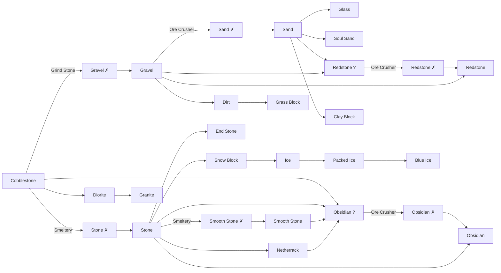

<div align="center">

# ⛏️ SimpleMaterialGenerators

**A Slimefun addon that generates basic materials for you, so you don't have to go out and mine them.**

[](https://github.com/mybezo/SMG/actions/workflows/maven.yml)


[](LICENSE)

</div>

---

## ✨ Features

- **20 generators** for building blocks, ice, stone variants and more
- **Built-in 54-slot inventory**: no chest or multiblock needed, just place the generator
- **Cargo support**: pull the output with Slimefun cargo nodes
- **[Networks Expansion](https://github.com/mybezo/NetworksExpansion) support**: Network Grabbers and other network blocks can pull the output
- **Progression**: most generators are crafted from earlier ones
- **Configurable speed** for every generator
- **Compressed generators**: up to 64 generators combined into one block

## 📦 Requirements

| | |
|---|---|
| **Server** | Spigot or Paper, Minecraft **1.16 – 26.3** |
| **Java** | **21** or newer |
| **Slimefun** | [Slimefun4-Gugu](https://github.com/mybezo/Slimefun4-Gugu), download it from [resources.guizhanss.com](https://resources.guizhanss.com/plugin/Slimefun4) |

> [!IMPORTANT]
> The official Slimefun4 is **not** supported. This addon uses the block storage API
> of the SlimefunGuguProject fork.

## 🚀 Installation

1. Install [Slimefun4-Gugu](https://github.com/mybezo/Slimefun4-Gugu).
2. Put `SimpleMaterialGenerators.jar` in your server's `plugins` folder.
3. Restart the server.
4. Find the generators in the Slimefun Guide under **Simple Material Generators** > **Material Generator**.

## 🎮 How it works

1. Craft a generator and place it anywhere.
2. It starts producing items straight away and stores them in its own inventory.
3. Right-click it to open the inventory and take the items out, or let cargo or Networks collect them.

```
┌───┬───┬───┬───┬───┬───┬───┬───┬───┐
│ ▒ │ ▒ │ ▒ │ ▒ │ ◆ │ ▒ │ ▒ │ ▒ │ ▒ │   ◆ status: progress or "Output is full"
├───┼───┼───┼───┼───┼───┼───┼───┼───┤
│   │   │   │   │   │   │   │   │   │
│   │   │   │   │   │   │   │   │   │
│   │   │   │   │   │   │   │   │   │   45 output slots
│   │   │   │   │   │   │   │   │   │
│   │   │   │   │   │   │   │   │   │
└───┴───┴───┴───┴───┴───┴───┴───┴───┘
```

- When all output slots are full, the generator pauses until there is space again.
- Items can only be taken **out**. Nothing can be put into a generator.
- Breaking a generator drops everything stored in it.

## 🧱 Generators

Speed is measured in Slimefun ticks. With Slimefun's default settings, 1 tick = 0.5 seconds.

| Generator | Speed | Time per item | Items per hour | Crafted in | Made from |
|---|:---:|:---:|:---:|---|---|
| Cobblestone | 4 t | 2 s | 1800 | Enhanced Crafting Table | Smooth Stone, Lava & Water Bucket, Iron Pickaxe |
| Stone | 8 t | 4 s | 900 | Enhanced Crafting Table | Stone Generator *(Broken)*, Stone, Solder Ingot |
| Smooth Stone | 12 t | 6 s | 600 | Smeltery | Smooth Stone Generator *(Broken)*, Smooth Stone, Steel Ingot, Iron Bars |
| Gravel | 6 t | 3 s | 1200 | Enhanced Crafting Table | Gravel Generator *(Broken)*, Stone Bricks, Billon Ingot |
| Sand | 8 t | 4 s | 900 | Enhanced Crafting Table | Sand Generator *(Broken)*, Sandstone, Duralumin Ingot |
| Glass | 12 t | 6 s | 600 | Smeltery | Sand Generator, Bronze Ingot, Brass Ingot, 8-Carat Gold |
| Netherrack | 6 t | 3 s | 1200 | Enhanced Crafting Table | 4× Stone Generator, Solder Ingot, Lava Bucket, Composter |
| Soul Sand | 8 t | 4 s | 900 | Enhanced Crafting Table | 2× Sand Generator, Steel Ingot, Water Bucket, mob drops, Composter |
| Redstone | 24 t | 12 s | 300 | Enhanced Crafting Table | 4× Redstone Generator *(Broken)*, Gravel Generator, Damascus Steel, Duralumin |
| Obsidian | 128 t | 64 s | ≈56 | Enhanced Crafting Table | 4× Obsidian Generator *(Broken)*, Stone Generator, Reinforced Alloy Ingot |
| Dirt | 20 t | 10 s | 360 | Enhanced Crafting Table | Gravel Generator, Dirt, Bronze Ingot, Composter |
| Grass Block | 20 t | 10 s | 360 | Enhanced Crafting Table | Dirt Generator, Grass Block, Wheat Seeds, Bone Meal, Water Bucket |
| Clay Block | 20 t | 10 s | 360 | Enhanced Crafting Table | Sand Generator, Clay, Water Bucket, Redstone Alloy Ingot |
| Diorite | 20 t | 10 s | 360 | Enhanced Crafting Table | Cobblestone Generator, Diorite, Quartz, Aluminum Ingot |
| Granite | 20 t | 10 s | 360 | Enhanced Crafting Table | Diorite Generator, Granite, Quartz, Copper Ingot |
| Snow Block | 20 t | 10 s | 360 | Enhanced Crafting Table | Stone Generator, Snow Block, Snowball, Water Bucket, Hardened Metal |
| Ice | 20 t | 10 s | 360 | Enhanced Crafting Table | Snow Block Generator, Ice, Snow Block, Water Bucket, Aluminum Ingot |
| Packed Ice | 20 t | 10 s | 360 | Enhanced Crafting Table | Ice Generator, Packed Ice, Ice, Damascus Steel Ingot |
| Blue Ice | 20 t | 10 s | 360 | Enhanced Crafting Table | Packed Ice Generator, Blue Ice, Packed Ice, Steel Ingot, Cooling Unit |
| End Stone | 20 t | 10 s | 360 | Enhanced Crafting Table | Stone Generator, End Stone, Ender Pearl, Reinforced Alloy Ingot |

Check the Slimefun Guide in game for the exact recipe layouts.

### 🌳 Progression

Some generators first have to be turned into a *Broken* or *Badly Formed* generator
and then repaired. An arrow means "used to craft".



<sub>✗ = Broken, ? = Badly Formed</sub>

## 🗜️ Compressed generators

A compressed generator combines several generators into one block. Every generator has
four compressed versions, crafted in the Slimefun **Compressor**:

| Version | Recipe | Items per cycle |
|---|---|:---:|
| Cobblestone Generator (8) | 8× the original generator | 8 |
| Cobblestone Generator (16) | 2× the (8) version | 16 |
| Cobblestone Generator (32) | 2× the (16) version | 32 |
| Cobblestone Generator (64) | 2× the (32) version | 64 |

- It runs at the same speed as the original generator and follows its `rate` setting.
- Every cycle produces as many items as its multiplier, split into valid stacks. If the output
  has less room, only what fits is produced, so no items are lost.
- IDs are the original ID plus `_X8`, `_X16`, `_X32` or `_X64`, for example
  `SMG_GENERATOR_COBBLESTONE_X64`.
- In the guide, open **Simple Material Generators** and click **Compressed Items** (slot 40).
  Only the highest enabled version is listed. The lower versions are still craftable, click them in a recipe
  to view them.

Compressed generators are configured in `plugins/SimpleMaterialGenerators/compressed.yml`:

```yaml
enabled: true          # all compressed generators
multipliers:           # disabling one also disables every higher one
  x8: true
  x16: true
  x32: true
  x64: true
generators:            # per original generator
  SMG_GENERATOR_COBBLESTONE: true
  # ...
```

Missing options are added to an existing file automatically. Changes need a server restart.

## ⚙️ Configuration

Each generator's speed can be changed with its `rate` setting (1 – 1000 ticks) in
`plugins/Slimefun/Items.yml`:

```yaml
SMG_GENERATOR_DIRT:
  rate: 20
```

Restart the server after changing it.

> [!NOTE]
> If you update from an older version, `Items.yml` keeps the old values. Change them
> by hand, or delete a generator's entry to get the new default.

## 🛠️ Building from source

Requires JDK 21 or newer and Maven.

```sh
git clone https://github.com/mybezo/SMG.git
cd SMG
mvn package
```

The jar is written to `target/`.

## 🐛 Bug reports

Found a problem? [Open an issue](https://github.com/mybezo/SMG/issues) and include
the output of `/sf versions`.

## ❤️ Credits

- [waleks647](https://github.com/waleks647/SMG): original author of SimpleMaterialGenerators
- [SlimefunGuguProject](https://github.com/SlimefunGuguProject/SMG): maintained the Chinese version

## 📄 License

Licensed under the [GNU General Public License v3.0](LICENSE).
